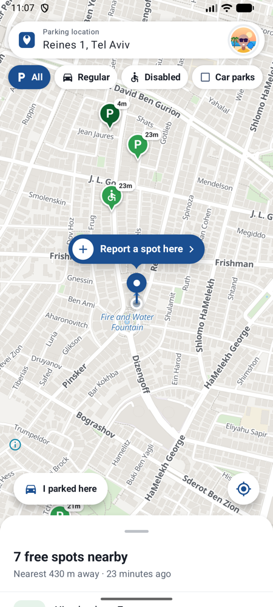
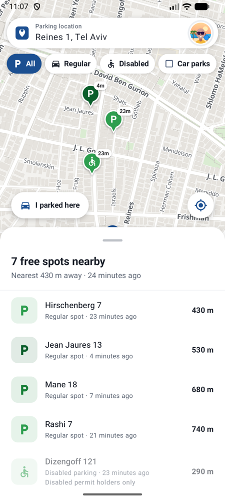
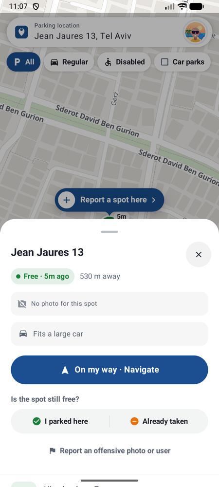
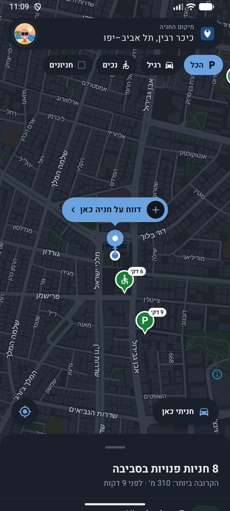
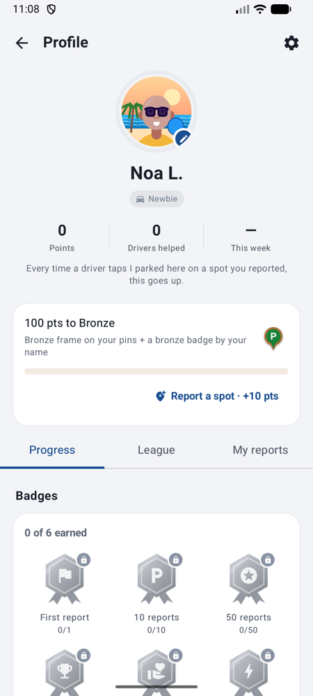
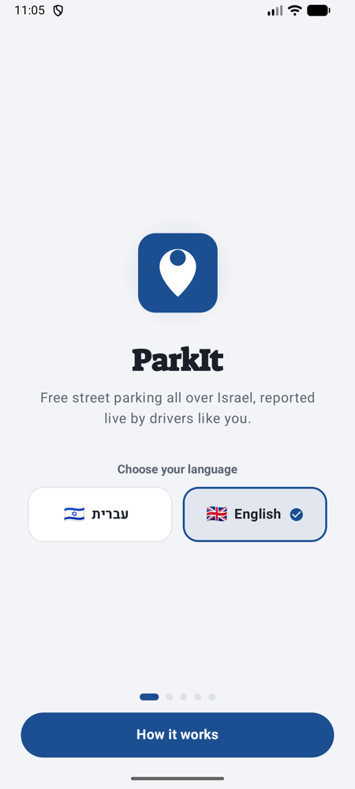
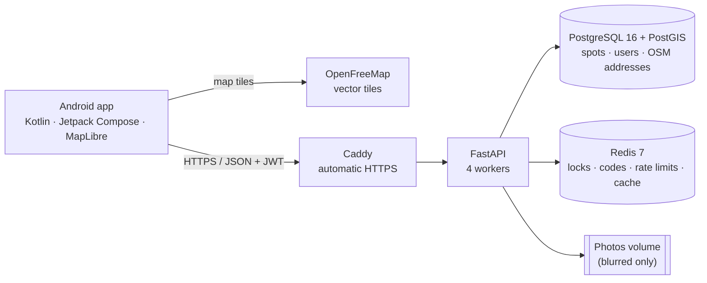

# ParkIt

[](https://github.com/EyalLin2/Parkit/actions/workflows/backend-ci.yml)
[](https://github.com/EyalLin2/Parkit/actions/workflows/android-ci.yml)


Crowdsourced **free street parking** for Israel. A driver leaving a spot reports it with one photo
(faces and licence plates blurred automatically), and drivers nearby see it on the map right away,
sorted by distance and freshness.

ParkIt is a real product in closed beta on Google Play, built end to end by one developer: a native
Android app, a Python API, a geospatial database, and a Dockerized production stack with HTTPS,
nightly backups and CI on every pull request.

| Map | Nearby list | Spot card | Report a spot |
| --- | --- | --- | --- |
|  |  |  |  |

| Hebrew, dark | Profile | Sign-up | Welcome |
| --- | --- | --- | --- |
|  |  |  |  |

## Features

**Find parking**
- Vector map with live pins: dark green is fresh, pale is older, orange means someone is on the way.
- Nearby list within 800 m with street address, distance and age; filters for regular, disabled and
  public car parks (OpenStreetMap).
- "On my way" holds the spot for you and opens Waze or Google Maps.
- "I parked here" / "Already taken" keep the map honest, and "I parked here" remembers where your car is.

**Report a spot**
- One tap from the map pin, mandatory photo, regular or disabled bay, car size, optional blue-white curb.
- The server checks you are really near the spot (150 m plus GPS accuracy) and merges duplicate
  reports within 15 m.
- Leaving? "I'm leaving" reports your own parked spot in one tap, no photo needed.

**Trust and privacy**
- Faces and licence plates are blurred on the server before a photo is stored; photos are deleted when
  the spot closes, and any user can take down an offensive photo immediately.
- Points, levels and badges reward good reports; false reports cost points and repeated ones block
  reporting.
- Sign-in with a 6-digit code by email or SMS: codes are stored only as an HMAC, expire after 5 minutes,
  burn after 5 wrong guesses, and sending is rate-limited per target and per IP.

**Everything else**
- Hebrew and English with full right-to-left layout, light and dark themes.
- Car profile from the licence plate (Israeli government vehicle registry), disabled-permit handling.
- Weekly city league, report history, in-app feedback and crash reports, account deletion.

## Engineering highlights

- **Replaced a rate-limited third-party geocoder with my own.** Public Nominatim allows about one
  request per second for the whole app. ParkIt imports Israel's OpenStreetMap extract into PostGIS
  (177K addresses, 105K streets, about 40 s) and resolves addresses with nearest-neighbour queries in
  8–35 ms, about 1 ms when cached. On 40 random street points it matched Nominatim's street name 40/40.
  ([geocoder.py](src/backend/geocoder.py), [importer](src/backend/import_osm_geodata.py))
- **Measured capacity instead of guessing it.** A load test ([scripts/loadtest.py](scripts/loadtest.py))
  found the knee at about 85 req/s, with throughput falling past it, plus concurrency bugs that only
  appear when users act at the same moment. Findings and fixes:
  [readiness review](docs/scalability/readiness-1000.md).
- **Server-side state machine for crowdsourced data.** Spots move active → claimed → taken / flagged /
  expired. Claims use Redis locks so two drivers are never sent to the same spot.
- **A release can't point at the wrong server.** One beta build was once compiled against the local dev
  URL. Release builds now default to production, and the URL is a tracked Gradle input so a stale value
  can't be cached.
- **Free to run.** MapLibre with OpenFreeMap tiles (no API key), a self-hosted geocoder, and an Oracle
  Cloud Always Free VM: infrastructure cost is zero.

## Architecture



Production runs as one Docker Compose stack on an Oracle Cloud ARM VM (4 cores, 24 GB). Only Caddy
is exposed to the internet; Postgres and Redis live on the private compose network.

| Layer | Tech |
| --- | --- |
| Mobile | Kotlin, Jetpack Compose (Material 3), MapLibre Native, Retrofit + Moshi, Coil, Google fused location |
| API | Python 3.12, FastAPI (async), Pydantic, SQLAlchemy 2 (async) + Alembic, JWT, OpenCV |
| Data | PostgreSQL 16 + PostGIS, Redis 7 |
| Maps & addresses | OpenFreeMap vector tiles with a custom style; OpenStreetMap (Geofabrik) imported into PostGIS |
| Infrastructure | Docker, Docker Compose, Caddy (Let's Encrypt), Oracle Cloud, cron + pg_dump backups |
| CI | GitHub Actions: ruff + pytest against real Postgres/Redis; Android build + lint; Dependabot |

## Run it locally

```bash
cp .env.example .env
docker compose -f deployments/docker/docker-compose.yml --env-file .env up -d --build
docker compose -f deployments/docker/docker-compose.yml --env-file .env exec backend alembic upgrade head

# one-off: load Israel's streets and addresses for the geocoder (~120 MB download, ~1 min)
docker compose -f deployments/docker/docker-compose.yml --env-file .env exec backend python import_osm_geodata.py

# optional: demo spots around Tel Aviv
docker compose -f deployments/docker/docker-compose.yml --env-file .env exec backend python seed_demo_spots.py

curl localhost:8000/healthz          # {"status":"ok","postgres":"ok","redis":"ok"}
open http://localhost:8000/docs      # interactive API docs
```

Android app: open `src/android` in Android Studio and run the debug build on an emulator; it talks to
the local stack at `10.0.2.2:8000` and shows sign-in codes on screen. Builds need JDK 21.

Tests and load test:

```bash
docker compose -f deployments/docker/docker-compose.yml --env-file .env exec backend python -m pytest
python scripts/loadtest.py --users 50 --seconds 30
```

## How changes ship

Feature branch → pull request → CI (lint, tests, Android build) → squash merge to `main` → deploy.
Details and the reasoning behind each check: **[CI/CD](docs/ci-cd.md)**. Operations:
[deploy](docs/runbooks/deploy.md) · [backup and restore](docs/runbooks/backup-restore.md).

## Repository structure

```
.github/             CI workflows, Dependabot, issue and PR templates
deployments/docker/  Local docker-compose stack
deployments/production/  Production stack: Caddy, backups
docs/                ADRs, CI/CD, runbooks, scalability review, screenshots
scripts/             Load test
src/backend/         FastAPI service, migrations, tests, OSM importer
src/android/         Native Android app
infra/               Terraform / Kubernetes (planned)
```

## Status and next steps

Closed beta on Google Play (0.3.5-beta). Known gaps, in order: off-site backups, a single server (no
failover yet), monitoring and alerts, infrastructure as code, push notifications for nearby spots. See
the [roadmap](ROADMAP.md) and [changelog](CHANGELOG.md).

Map data © [OpenStreetMap](https://www.openstreetmap.org/copyright) contributors, tiles by
[OpenFreeMap](https://openfreemap.org). Avatars: DiceBear Personas by Draftbit, CC BY 4.0.
