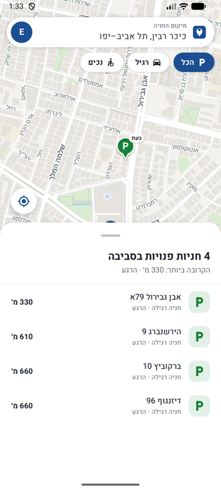
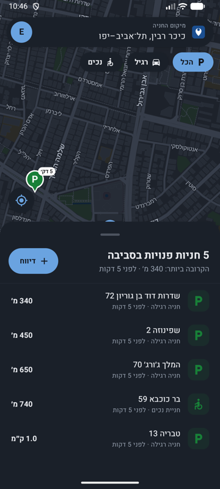
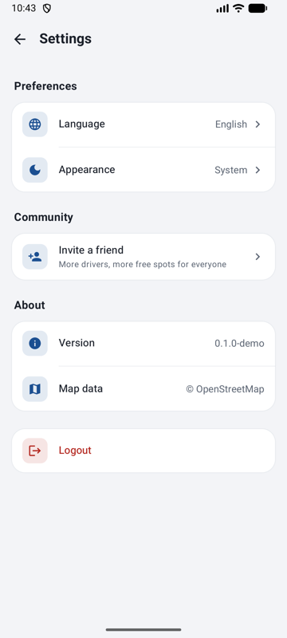
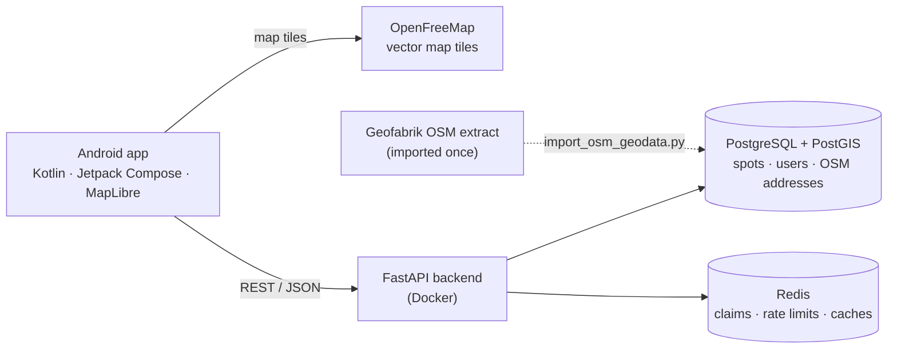

# ParkIt

[](https://github.com/EyalLin2/Parkit/actions/workflows/backend-ci.yml)

Crowdsourced **free street parking** for Israel. Drivers report a spot the moment they leave it — with a
photo, blurred for privacy — and drivers nearby see it on the map, sorted by distance and freshness.

ParkIt is also a DevOps showcase: a real app used to practise infrastructure-as-code, CI/CD,
containerisation, load testing and observability end to end.

| Map + nearby spots | Spot card | Dark mode | Settings |
| --- | --- | --- | --- |
|  |  |  |  |

## What works today

- **Report in one tap** from the map pin: mandatory photo with automatic face blur, regular or disabled
  spot, car size. +10 points per report.
- **Find parking**: vector map (Google-Maps-style light and dark themes), spots clustered on the map, a
  nearby list with street + house number, distance and freshness. Older reports fade.
- **Crowd verification**: "I'm heading there" (claim), "I parked here", "Already taken"; false reports cost
  points and repeated ones block reporting.
- **Profile**: points, progress to the next badge, report history, weekly leaderboard.
- **Hebrew and English** (full RTL), explicit dark mode.
- **Self-hosted geocoding**: addresses come from OpenStreetMap data in our own PostGIS — no third-party
  rate limits.

Current status and what is still missing: **[Readiness for 1,000 users](docs/scalability/readiness-1000.md)**
· [Open issues](https://github.com/EyalLin2/Parkit/issues) · [Roadmap](ROADMAP.md) · [Changelog](CHANGELOG.md)

## Engineering highlights

- **Replaced a rate-limited third-party geocoder with our own.** Public Nominatim allows ~1 request/s for
  the whole app. ParkIt imports Israel's OpenStreetMap extract into PostGIS (177K addresses, 105K streets,
  ~40 s) and resolves addresses with nearest-neighbour queries: 8–35 ms, ~1 ms cached. Validated against
  Nominatim on 40 random on-street points: **40/40 identical street names**, house numbers 33 vs 34.
  ([geocoder.py](src/backend/geocoder.py), [importer](src/backend/import_osm_geodata.py))
- **Measured capacity instead of guessing it.** A load test ([scripts/loadtest.py](scripts/loadtest.py))
  found the knee at ~85 req/s and showed throughput *falling* past it — plus two concurrency bugs that
  only appear when users act at the same moment. Findings and the fix plan:
  [readiness review](docs/scalability/readiness-1000.md).
- **Vector maps on a free stack.** MapLibre + OpenFreeMap with a hand-written style (one template, light
  and dark palettes, Hebrew/English street names) — no API key, no request limits.
- **Server-side state machine for crowdsourced data.** Spots move active → claimed → taken / flagged /
  expired; claims use Redis locks, reports are de-duplicated within 15 m, and points/penalties keep
  reports honest. Decisions are recorded as [ADRs](docs/adr/).
- **Privacy by default.** Photos are face-blurred before anyone sees them and deleted when the spot closes.

## Architecture



| Layer | Tech |
| --- | --- |
| Mobile | Kotlin, Jetpack Compose, MapLibre Native, Retrofit, Coil |
| API | Python 3.12, FastAPI, SQLAlchemy (async), Alembic, OpenCV (face blur) |
| Data | PostgreSQL 16 + PostGIS, Redis |
| Maps & addresses | OpenFreeMap vector tiles; OpenStreetMap (Geofabrik) imported into PostGIS |
| CI | GitHub Actions — ruff lint/format + pytest against real Postgres/Redis |

## Run it locally

```bash
cp .env.example .env
docker compose -f deployments/docker/docker-compose.yml --env-file .env up -d --build
docker compose -f deployments/docker/docker-compose.yml --env-file .env exec backend alembic upgrade head

# one-off: load Israel's streets and addresses for the geocoder (~120 MB download, ~1 min)
docker compose -f deployments/docker/docker-compose.yml --env-file .env exec backend python import_osm_geodata.py

curl localhost:8000/healthz          # {"status":"ok","postgres":"ok","redis":"ok"}
open http://localhost:8000/docs      # interactive API docs
```

Android app: open `src/android` in Android Studio and run it on an emulator (it talks to
`10.0.2.2:8000`). For a real device: `./gradlew assembleDebug -PapiBaseUrl=https://<your-host>/`.

Tests and load test:

```bash
docker compose -f deployments/docker/docker-compose.yml --env-file .env exec backend python -m pytest
python scripts/loadtest.py --users 50 --seconds 30
```

## Repository structure

```
.github/            CI workflows, issue and PR templates
deployments/docker/ Local docker-compose stack
docs/               Product spec, ADRs, scalability review, screenshots
infra/              Terraform / Kubernetes (planned)
scripts/            Load test and helpers
src/backend/        FastAPI service, migrations, tests, OSM importer
src/android/        Native Android app
```

## Working agreement

Feature branches and Conventional Commits, squash-merged through pull requests — see
[CONTRIBUTING.md](CONTRIBUTING.md). Architectural decisions live in [docs/adr/](docs/adr/).

Map data © [OpenStreetMap](https://www.openstreetmap.org/copyright) contributors, tiles by
[OpenFreeMap](https://openfreemap.org).
