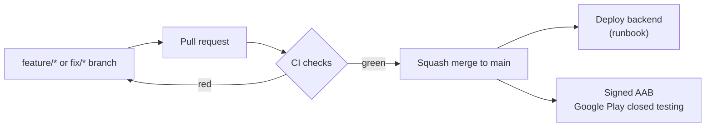

# CI/CD

How a change gets from a branch to users, which checks run on the way, and why each one exists.

## The rule

`main` is protected: nothing lands without a pull request, force pushes and deletion are blocked.
Each PR is squash-merged, so `main` reads as one commit per change, with the PR number in the message.

## Checks on every pull request

| Workflow | Job | What it does | Why it's there |
| --- | --- | --- | --- |
| Backend CI | `lint` | `ruff check` + `ruff format --check` | Catches unused imports, undefined names and common bugs before review, and keeps one style so diffs show logic, not formatting. |
| Backend CI | `test` | 144 pytest tests against real PostGIS and Redis service containers | The core logic is SQL and Redis: distance queries, locks, rate limits, code expiry. Mocks would hide exactly the bugs that matter, so tests run against the real engines. |
| Backend CI | `migrations` | Every Alembic migration on an empty database, then one step down and up again | Tests create tables straight from the models, so a broken migration would pass them and only fail on the server. This job found a real one: a fresh database had no PostGIS, so the first migration failed. That's the path a restore or a new server takes. |
| Backend CI | `docker` | Builds the production image (with layer cache) | Production runs this image. A bad Dockerfile line or a dependency that won't install fails here instead of during a deploy. |
| Android CI | `build` | `assembleDebug` + `lintDebug`, uploads the APK and the lint report | Proves the app compiles on a clean machine (not only on mine), and Android lint catches platform bugs: missing translations, calls above the minimum API level, accessibility. Runs only when `src/android/**` changes, so backend PRs stay fast. |

Pull requests also get:

- **Concurrency cancel**: a new push cancels the outdated run, so the result always matches the latest code.
- **Dependabot** (weekly): PRs for outdated pip, Gradle, Docker and GitHub Actions dependencies. Each one
  runs the same checks, so an update that breaks something is never merged blind.

## Delivery

**Backend.** After merge, the server pulls `main`, rebuilds the image and applies migrations
(see [runbooks/deploy.md](runbooks/deploy.md)). It runs as a Docker Compose stack behind Caddy, which
handles HTTPS. Healthchecks gate startup: the API starts only after Postgres and Redis report healthy,
and `restart: unless-stopped` brings back a crashed container.

**Android.** `versionCode` goes up by one per upload. `./gradlew bundleRelease` builds a minified (R8),
signed AAB; the upload key lives outside the repo (`~/.parkit/`), so it can never be committed. Release
builds default to the production URL: one early build silently pointed at the dev server, so the build
now makes that mistake impossible. Google Play re-signs with its own key (Play App Signing) and ships
to closed testers before production.

**Data.** `deployments/production/backup.sh` runs nightly from cron: a `pg_dump`, gzipped, 14 days kept.
Restore steps: [runbooks/backup-restore.md](runbooks/backup-restore.md).

## What's next

- **Automated deploy**: a workflow that deploys `main` over SSH after CI passes, with a post-deploy
  `/healthz` check and automatic rollback to the previous image.
- **Off-site backups**: copy each dump to object storage, so losing the server doesn't lose the data.
- **Signed release builds in CI**: build the AAB from a tag, with the keystore in GitHub encrypted
  secrets, and attach it to a GitHub release.
- **Monitoring**: uptime checks on `/healthz` and error-rate alerts.
